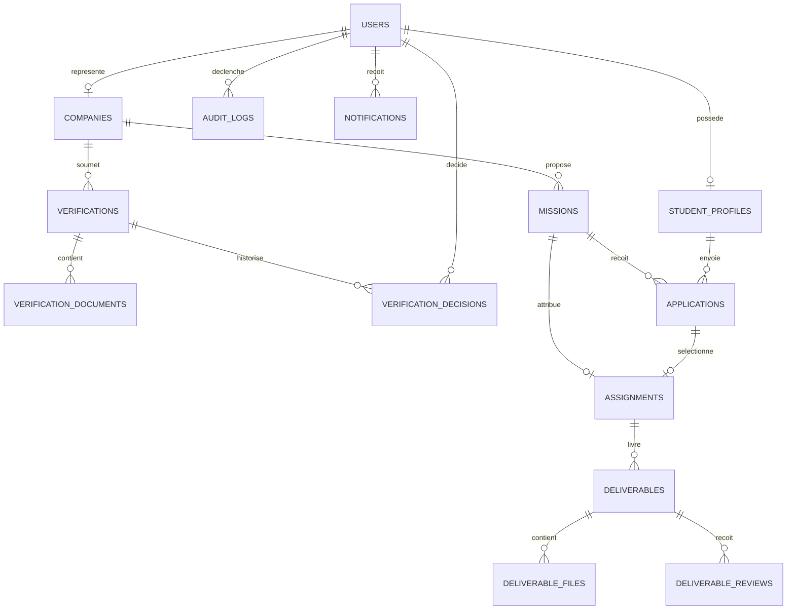

# Modèle MySQL et ERD

Modèle logique proposé. Les migrations Laravel utiliseront MySQL/InnoDB, `utf8mb4`, des clés étrangères et des dates UTC. Les identifiants métiers ICE et RC sont des chaînes pour conserver leur représentation. Les identifiants de ressources dans l’API sont opaques pour le client. Leur format final fait partie de la validation.

| Table | Champs et contraintes principales |
| --- | --- |
| `users` | ID, nom, e-mail normalisé unique, hash, rôle enum, `email_verified_at`. Sessions, récupération et notifications via les tables Laravel. |
| `student_profiles` | FK unique vers utilisateur, établissement optionnel, compétences et visibilité privée |
| `companies` | FK unique vers représentant MVP, raison sociale, ICE normalisé unique, RC, ville d’immatriculation, référence du greffe si disponible, e-mail professionnel vérifié, nom et fonction du représentant, statut |
| `verifications` | Entreprise, numéro de tentative unique par entreprise, état du dossier, instantané à la soumission, dates. Au plus une tentative ouverte via verrou sur l’entreprise. |
| `verification_documents` | Dossier, type de pièce, clé privée, MIME, taille, empreinte, état antivirus, dates. Clé de stockage unique. |
| `verification_decisions` | Dossier, admin, état précédent et suivant, motif public, notes internes, références des contrôles et date. Historique append-only. |
| `missions` | Entreprise, titre, description, durée, compétences, livrable attendu, date limite de candidature, état, date de publication |
| `mission_attachments` | Mission, nom d’origine affiché, clé de stockage privé unique. Jusqu’à trois documents fournis par l’entreprise. |
| `student_profiles` | Profil lié au compte étudiant, bio, compétences, liens professionnels et clé de photo privée. |
| `company_profiles` | Profil de présentation lié au compte entreprise, ville, secteur, description, site web et clé de photo privée. Séparé du dossier légal. |

Le champ nullable `applications.rejected_at` conserve un refus explicite de l’entreprise, indépendamment de l’attribution de la mission.
| `applications` | Mission, étudiant, message, état et dates. Unicité `(mission_id, student_profile_id)`. |
| `assignments` | Mission unique, candidature unique, échéance, dates. Garantir que la candidature sélectionnée appartient à la mission avec une FK composite ou une contrainte transactionnelle explicitement testée. |
| `deliverables` | Attribution, version unique par attribution, note et état |
| `deliverable_files` | Livrable, clé privée unique, MIME, taille, empreinte, état antivirus |

Le suivi actuel accepte une pièce jointe privée par mission. La colonne nullable `missions.delivery_attachment_path` contient sa clé de stockage. Les colonnes `delivery_scan_status` et `delivery_link_reported_at` conservent les décisions précédentes. L’analyse automatique, le signalement de liens et les versions multiples restent dans la roadmap.
| `deliverable_reviews` | Version, auteur autorisé, décision, motif, date. Garder l’historique. |
| `audit_logs` | Acteur, événement, type et ID de cible, référence de requête, métadonnées minimales et date |
| `ai_evaluations` | Après MVP. Version de livrable, fournisseur, version d’évaluation, statut, résultat structuré, décision humaine. Clé d’idempotence unique. |

Prévoir des index sur `companies(status, id)`, `verifications(status, submitted_at, id)`, `missions(status, published_at, id)`, `missions(company_id, status, id)`, `applications(student_profile_id, id)` et les dates des logs. Valider l’unicité du RC dans le périmètre d’un greffe normalisé avant d’ajouter un index unique composite. Le format de recherche et les index texte seront choisis avec les données de test.

Verrouiller les lignes d’entreprise et de mission dans un ordre stable lors des transitions critiques. Les transactions couvrent soumission et décision de vérification, attribution unique, création de versions et clôture. Les notifications se déclenchent après commit. Le stockage privé est hors transaction SQL. Prévoir la compensation et une réconciliation pour les fichiers orphelins. Préserver les preuves et décisions selon une durée approuvée, avec purge contrôlée. Les seeds emploient exclusivement des données fictives et les factories couvrent tous les rôles et états.
